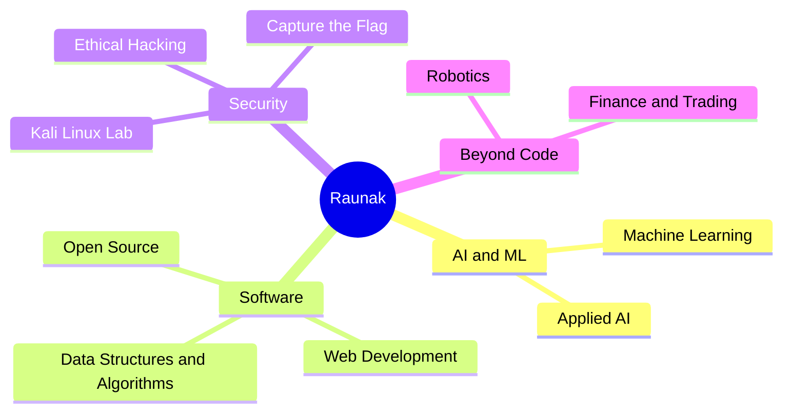

<div align="center">


<a href="https://git.io/typing-svg">
  
</a>

<br/>


<br/><br/>

<a href="https://github.com/raunakcse25-star"></a>
<a href="https://www.linkedin.com/in/raunak-kumar-sahni-64239a270"></a>
<a href="mailto:raunakkumar3821@gmail.com"></a>
<a href="https://leetcode.com/u/raunak_sahnii/"></a>
<a href="https://www.geeksforgeeks.org/user/raunakkuxu68/"></a>
<a href="https://tryhackme.com/p/raunaksahni7286"></a>
<a href="https://www.hackerrank.com/profile/raunaksahni7286"></a>
<a href="https://labex.io/u/raunak-sahni-00406446"></a>
<a href="https://www.instagram.com/raunak_sahnii"></a>

</div>


## 🚀 About Me

I'm **Raunak Kumar Sahni**, a **Computer Science Engineering** student at **Delhi Technical Campus (affiliated to GGSIPU)**. I enjoy building impactful software, exploring Artificial Intelligence, solving real-world problems and steadily sharpening my engineering skills, with **cybersecurity as a growing side track**.

```js
const raunak = {
  name:        "Raunak Kumar Sahni",
  role:        "B.Tech CSE Student · Full Stack & AI/ML Enthusiast",
  college:     "Delhi Technical Campus (GGSIPU)",
  sideTrack:   "Cybersecurity · Ethical Hacking · Kali Linux (VirtualBox)",
  practising:  ["LeetCode", "GeeksforGeeks", "TryHackMe", "HackerRank", "LabEx"],
  currently:   "Building full-stack projects & learning AI/ML",
  funFact:     "I treat every bug as a puzzle waiting to be solved 🧩",
  motto:       "In a world of algorithms, be the one who creates solutions."
};
```

### 🎯 Mission
- 🤖 Become an **AI & Machine Learning Engineer**
- 🏢 Crack a **top product-based company**
- 💡 Build innovative products that solve real problems
- 🚀 Launch my own **technology startup**
- 🌍 Grow into a strong **open-source contributor**
- 🛡️ Build a solid **cybersecurity** foundation alongside development

---

## 🎓 Education

| 🎒 Qualification | 🏫 Institute | 📊 Score |
|---|---|---:|
| **B.Tech CSE** | Delhi Technical Campus (GGSIPU) | Pursuing |
| **Class XII** | Delhi Scholars International School | **91%** |
| **Class X** | Delhi Scholars International School | **94%** |

---

## 💻 Tech Stack

<div align="center">

**Languages**


**Frameworks, Tools & Platforms**


**Security & Labs**


</div>

### 🧠 Interests



---

## 🛡️ Cybersecurity Side Quest

> *Development is my main road; cybersecurity is the side operation that makes me a better, more security-aware engineer.*

<div align="center">


</div>

| 🧪 Focus | 🔧 Lab setup | 🎯 Goal |
|---|---|---|
| Ethical hacking fundamentals, networking and Linux, hands-on rooms and labs | **Kali Linux** running in **VirtualBox** (isolated VM) | Build practical, legal skills through CTFs and guided labs |

> ⚠️ All practice happens in **isolated lab environments** and on platforms that explicitly permit testing.

---

## 📚 Learning & Practice Essentials

<div align="center">

| Platform | Purpose | Link |
|:---:|---|:---:|
|  | DSA problem-solving and interview prep | [**raunak_sahnii**](https://leetcode.com/u/raunak_sahnii/) |
|  | Core CS concepts and DSA practice | [**@raunakkuxu68**](https://www.geeksforgeeks.org/user/raunakkuxu68/) |
|  | Guided cybersecurity rooms and learning paths | [**raunaksahni7286**](https://tryhackme.com/p/raunaksahni7286) |
|  | Coding challenges and skill certifications | [**@raunaksahni7286**](https://www.hackerrank.com/profile/raunaksahni7286) |
|  | Hands-on interactive Linux and DevOps labs | [**raunak-sahni-00406446**](https://labex.io/u/raunak-sahni-00406446) |
|  | Ethical-hacking journey and practice | Learning in progress |

</div>

<div align="center">


</div>

### 📈 Current Learning

```text
DSA                     ████████████░░░░░   Problem solving daily
JavaScript              ███████████░░░░░░   Deepening core + ES6+
React                   ████████░░░░░░░░░   Building real projects
AI / Machine Learning   ███████░░░░░░░░░░   Foundations → applied
Open Source             █████████░░░░░░░░   Contributing consistently
Cybersecurity           ██████░░░░░░░░░░░   Kali + guided labs
```

---

## 🏆 Achievements

- 🏅 **Smart India Hackathon** participant
- 🚀 **FOSS Hackathon** participant
- 🌍 **Open-source** contributor
- 🎓 **94%** in Class X
- 🎓 **91%** in Class XII

---

## 📂 Featured Projects

<div align="center">

<a href="https://github.com/raunakcse25-star/reboot-earth-e-waste-optimizer">
  
</a>

</div>

| 🔹 Project | 📝 What it is | 🧰 Highlights |
|---|---|---|
| 🌍 **[Reboot Earth](https://github.com/raunakcse25-star/reboot-earth-e-waste-optimizer)** | Full-stack e-waste collection, logistics-optimisation and AI-assistance platform | React · TypeScript · Express · PostgreSQL · Gemini (EcoBot) · 2-opt route optimiser |
| 🔹 **JS-Code** | A well-organised JavaScript learning repository with concepts, examples and practice | JavaScript fundamentals |
| 🔹 **ECO** | Open-source hackathon project focused on solving real-world problems collaboratively | Team collaboration |
| 🔹 **ThreadCO** | Modern e-commerce website showcasing responsive UI and scalable architecture | Responsive UI |
| 🔹 **Banking Management System** | Console-based system implementing core banking operations | Core logic and OOP |

---

## 📊 GitHub Intelligence Report

<div align="center">


<br/>


<br/>


<br/>


</div>


### 📈 Contribution Graph

<div align="center">
  
</div>

---

## 🎯 2030 Vision

- [ ] 🤖 AI & Machine Learning Engineer
- [ ] 🧮 1000+ LeetCode problems
- [ ] 🏢 Product-based company
- [ ] 🌍 Established open-source contributor
- [ ] 🛠️ Build innovative products
- [ ] 🚀 Launch a startup
- [ ] 🛡️ Strong cybersecurity foundation
- [ ] 💫 Inspire others through technology

---

## 🌐 Connect With Me

<div align="center">

| Channel | Handle | Link |
|:---:|---|:---:|
|  | raunakcse25-star | [Open](https://github.com/raunakcse25-star) |
|  | Raunak Kumar Sahni | [Open](https://www.linkedin.com/in/raunak-kumar-sahni-64239a270) |
|  | raunakkumar3821@gmail.com | [Mail](mailto:raunakkumar3821@gmail.com) |
|  | raunak_sahnii | [Open](https://leetcode.com/u/raunak_sahnii/) |
|  | @raunakkuxu68 | [Open](https://www.geeksforgeeks.org/user/raunakkuxu68/) |
|  | raunaksahni7286 | [Open](https://tryhackme.com/p/raunaksahni7286) |
|  | @raunaksahni7286 | [Open](https://www.hackerrank.com/profile/raunaksahni7286) |
|  | raunak-sahni-00406446 | [Open](https://labex.io/u/raunak-sahni-00406446) |
|  | raunak_sahnii | [Open](https://www.instagram.com/raunak_sahnii) |

</div>

---

<div align="center">

### 💡 Favourite Quote

> **"Build something today that the world will depend on tomorrow."**

⭐ **If you like my work, consider giving my repositories a star!**


</div>

```js
// ══════════════════════════════════════════════════════════════
//  END OF FILE : Raunak Kumar
//  © raunakcse25-star  ·  In a world of algorithms, be the one who creates solutions.
// ══════════════════════════════════════════════════════════════
```
